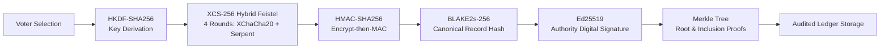

# Secure E-Voting System with Enhanced Vote Verification and Tamper-Evident Auditing

[]()
[]()
[]()
[]()
[]()

A complete, production-grade academic demonstration for **Cryptography and Network Security (C&NS)** capstone engineering. This system demonstrates an end-to-end electronic voting architecture with strict separation between public voters and security administrators, an experimental 4-round hybrid Feistel cipher (**XCS-256**), deterministic BLAKE2s record hashing, unforgeable Ed25519 digital signatures, domain-separated Merkle tree auditing, and an isolated real-time tamper detection sandbox.

---

## Architecture and Cryptographic Pipeline



### XCS-256 Four-Round Hybrid Feistel Construction (Experimental)

```mermaid
flowchart TD
    P[Input: 256-bit Padded Block] --> S[Split into L0 and R0 - 128-bit each]
    S --> R1["Round 1: F1(R0, K1, Nonce1)\nRaw XChaCha20 Keystream\nL1 = R0; R1 = L0 ⊕ F1(R0)"]
    R1 --> R2["Round 2: F2(R1, K2)\nSerpent 128-bit Block Cipher\nL2 = R1; R2 = L1 ⊕ F2(R1)"]
    R2 --> R3["Round 3: F3(R2, K3, Nonce2)\nRaw XChaCha20 Keystream\nL3 = R2; R3 = L2 ⊕ F3(R2)"]
    R3 --> R4["Round 4: F4(R3, K4)\nSerpent 128-bit Block Cipher\nL4 = R3; R4 = L3 ⊕ F4(R3)"]
    R4 --> Sw[Final Feistel Swap: R4 || L4]
    Sw --> C[Output: 256-bit Ciphertext Block]
```

> [!CAUTION]
> **RESEARCH PROTOTYPE NOTICE:** XCS-256 is an experimental research cipher combining raw XChaCha20 stream generation with Serpent 128-bit block substitution for academic evaluation. It is not an NIST-standardized or formally proven cipher. Never deploy it in national or high-stakes elections.

---

## Core Features

1. **Dual Role Architecture:**
   - **Public & Voter Experience:** Approaches voting with modern accessibility. Includes registration, email verification token flow, election browsing, single-ballot casting, non-sequential Vote ID (`VOTE-XXXX-XXXX-XXXX`), and zero-disclosure ballot verification.
   - **Admin & Security Console:** High-density administrative interface with election lifecycle control, voter status management, live cryptographic telemetry, full ledger integrity verification, and audit logs.
2. **Applied Cryptographic Pipeline:**
   - **Argon2id:** Password hashing with memory-hard parameters.
   - **HKDF-SHA256:** Per-ballot key expansion using distinct ASCII domain strings.
   - **XCS-256 Feistel Cipher:** 256-bit block cipher with alternating XChaCha20 and Serpent rounds in CBC mode with PKCS#7 padding.
   - **HMAC-SHA256:** Encrypt-then-MAC authentication over version, salt, IV, and ciphertext.
   - **Canonical RFC 8785 JSON:** Eliminates byte-level serialization variance.
   - **BLAKE2s-256:** High-performance ballot record hashing.
   - **Ed25519:** Pure digital signatures by the election authority over record hashes.
   - **Merkle Tree:** Prefix domain-separated (`0x00` leaf, `0x01` node) binary hash tree providing logarithmic inclusion proofs.
3. **Strict Privacy Safeguards:**
   - Candidate choices are **never** returned by the public `/verification/verify` route.
   - Database level `UNIQUE(voter_id, election_id)` constraint prevents double-voting.
4. **Tamper Detection Demonstration Sandbox:**
   - Isolated testing environment allowing administrators to mutate test records (flipping ciphertext bits or modifying tags) to observe and demonstrate live cryptographic failures (HMAC rejection, BLAKE2s mismatch, Ed25519 signature failure, Merkle root shift) and reset cleanly.

---

## Directory Structure

```
secure-e-voting-system/
├── README.md                          # Project documentation and guide
├── .gitignore                         # Git exclusion rules
├── .env.example                       # Environment configuration template
├── docs/                              # Formal engineering documentation
│   ├── architecture.md                # System components & data flow
│   ├── threat-model.md                # Security boundaries, attackers & mitigations
│   ├── cryptography-design.md         # Pipeline design & RFC specifications
│   ├── xcs256-specification.md        # Mathematical Feistel specification
│   ├── api-reference.md               # Complete REST API documentation
│   ├── database-schema.md             # ER diagrams and table models
│   ├── limitations.md                 # Cryptographic & privacy limitations
│   ├── testing-report.md              # Automated test suite results
│   └── user-guide.md                  # Step-by-step user and admin guide
├── backend/                           # Python FastAPI Application
│   ├── requirements.txt               # Pinned Python dependencies
│   ├── pytest.ini                     # Pytest configuration
│   ├── evoting.db                     # SQLite database (auto-generated)
│   ├── app/
│   │   ├── main.py                    # Application entrypoint & CORS setup
│   │   ├── core/                      # Config, Argon2id security & RBAC
│   │   ├── db/                        # Database session & Base models
│   │   ├── models/                    # User, Election, Candidate, VoteRecord, etc.
│   │   ├── schemas/                   # Pydantic request/response schemas
│   │   ├── crypto/                    # Applied Cryptography Engine
│   │   │   ├── key_derivation.py      # HKDF-SHA256 with domain separation
│   │   │   ├── xchacha_round.py       # Raw XChaCha20 round function (F1, F3)
│   │   │   ├── serpent_round.py       # Serpent 128-bit block function (F2, F4)
│   │   │   ├── feistel.py             # 4-round balanced Feistel encrypt/decrypt
│   │   │   ├── authentication.py      # HMAC-SHA256 Encrypt-then-MAC
│   │   │   ├── xcs256.py              # Multi-block CBC cipher with PKCS#7
│   │   │   ├── serialization.py       # Deterministic RFC 8785 canonical bytes
│   │   │   ├── hashing.py             # BLAKE2s-256 record hashing
│   │   │   ├── signatures.py          # Ed25519 digital signatures
│   │   │   └── merkle_tree.py         # Merkle tree & inclusion proofs
│   │   ├── services/                  # Business logic services
│   │   └── api/routes/                # REST endpoints
│   └── tests/                         # Automated test suite (35 tests)
├── frontend/                          # React 19 + TypeScript + Vite Client
│   ├── package.json                   # Dependencies
│   ├── vite.config.ts                 # Vite bundler & API reverse proxy
│   ├── tsconfig.json                  # TypeScript compiler settings
│   └── src/
│       ├── context/                   # AuthContext with role detection
│       ├── components/                # Layout, AdminSidebar, Navbar, Footers
│       ├── pages/                     # Public, Voter, Auth & Admin views
│       ├── services/                  # Axios API client
│       └── types/                     # TypeScript data interfaces
└── scripts/                           # Utility scripts
    ├── seed_demo.py                   # Database seeding with elections & voters
    ├── setup.sh / setup.bat           # Cross-platform installation scripts
    └── run_tests.sh / run_tests.bat   # Automated test runners
```

---

## Quick Start & Installation

### Prerequisites
- Python 3.11+ (Python 3.13 tested)
- Node.js 18+ and npm 9+ (Node v24 tested)
- Git

### 1. Automated Setup (Recommended)
On Windows:
```cmd
cd scripts
setup.bat
```
On Linux / macOS / WSL:
```bash
chmod +x scripts/*.sh
./scripts/setup.sh
```

### 2. Manual Setup Instructions

#### Backend Setup
```bash
cd backend
python -m pip install -r requirements.txt
python ../scripts/seed_demo.py
uvicorn app.main:app --reload --port 8000
```
Backend API will be accessible at: `http://127.0.0.1:8000`  
Swagger API Documentation: `http://127.0.0.1:8000/docs`

#### Frontend Setup
```bash
cd frontend
npm install
npm run dev
```
Frontend web application will run at: `http://localhost:5173`

---

## Running Automated Tests

Run the full automated test suite containing 35 cryptographic and integration tests:

```bash
# Backend pytest suite
cd backend
python -m pytest -v

# Frontend typecheck & production build
cd ../frontend
npm run build
```

Or using the automated script:
```cmd
scripts\run_tests.bat      # Windows
./scripts/run_tests.sh     # Linux / macOS
```

**Test Results:** **35 passed in 1.78 seconds** (100% pass rate).

---

## Demo Credentials

The database is pre-seeded with realistic election data:

| Role | Email | Password | Details |
| :--- | :--- | :--- | :--- |
| **Admin** | `admin@evoting.gov` | `AdminSecurePass123!` | Access to `/admin/login` & Security Suite |
| **Voter** | `alice@evoting.gov` | `VoterPass123!` | Verified; already voted in Student Council |
| **Voter** | `bob@evoting.gov` | `VoterPass123!` | Verified; already voted in Student Council |
| **Voter** | `charlie@evoting.gov` | `VoterPass123!` | Verified; ready to cast ballot |
| **Voter** | `dave@evoting.gov` | `VoterPass123!` | Unverified account for email verification test |

> *Tip:* Both `/login` and `/admin/login` feature **"Quick Demo Login"** buttons that fill credentials with a single click.

---

## College Viva & Examination Quick-Reference

1. **What is a Feistel network?**
   A symmetric block cipher design where a block is split into two halves ($L, R$). In each round, $L_i = R_{i-1}$ and $R_i = L_{i-1} \oplus F(R_{i-1}, K_i)$. Decryption is identical to encryption, simply traversing round keys in reverse, regardless of whether $F$ is mathematically invertible.
2. **Why use XChaCha20 and Serpent in XCS-256?**
   - **XChaCha20** provides rapid stream generation with an extended 192-bit nonce, eliminating risk of nonce collision.
   - **Serpent** was an AES finalist renowned for its ultra-conservative security margin (32 rounds of S-box substitution).
   - Alternating them in 4 rounds explores a hybrid stream/block Feistel paradigm.
3. **Why is Encrypt-then-MAC crucial?**
   It computes the HMAC tag over the final ciphertext block. If an attacker tampers with a single bit, the MAC check fails immediately before any decryption occurs, preventing padding-oracle and chosen-ciphertext attacks.
4. **Why use BLAKE2s-256 for record hashing?**
   BLAKE2s is faster than MD5, SHA-1, and SHA-256, provides 256-bit security, and has built-in immunity against length-extension attacks.
5. **Why use Ed25519 for digital signatures?**
   Ed25519 provides 128-bit classical security with 64-byte signatures, high performance, and is immune to cache-timing side-channel vulnerabilities.
6. **How does the Merkle tree support voter verification?**
   Ballot hashes are leaf nodes. An inclusion proof consists of $O(\log_2 N)$ sibling hashes connecting a voter's leaf to the published Merkle root, proving their vote was committed to the ledger without disclosing the candidate choice.

---

## Detailed Documentation Links
- [System Architecture](docs/architecture.md)
- [Threat Model & Security Boundaries](docs/threat-model.md)
- [Cryptographic Pipeline Design](docs/cryptography-design.md)
- [XCS-256 Mathematical Specification](docs/xcs256-specification.md)
- [REST API Reference](docs/api-reference.md)
- [Database Schema & Models](docs/database-schema.md)
- [Cryptographic & Architectural Limitations](docs/limitations.md)
- [Automated Testing Report](docs/testing-report.md)
- [End-to-End User Guide](docs/user-guide.md)
