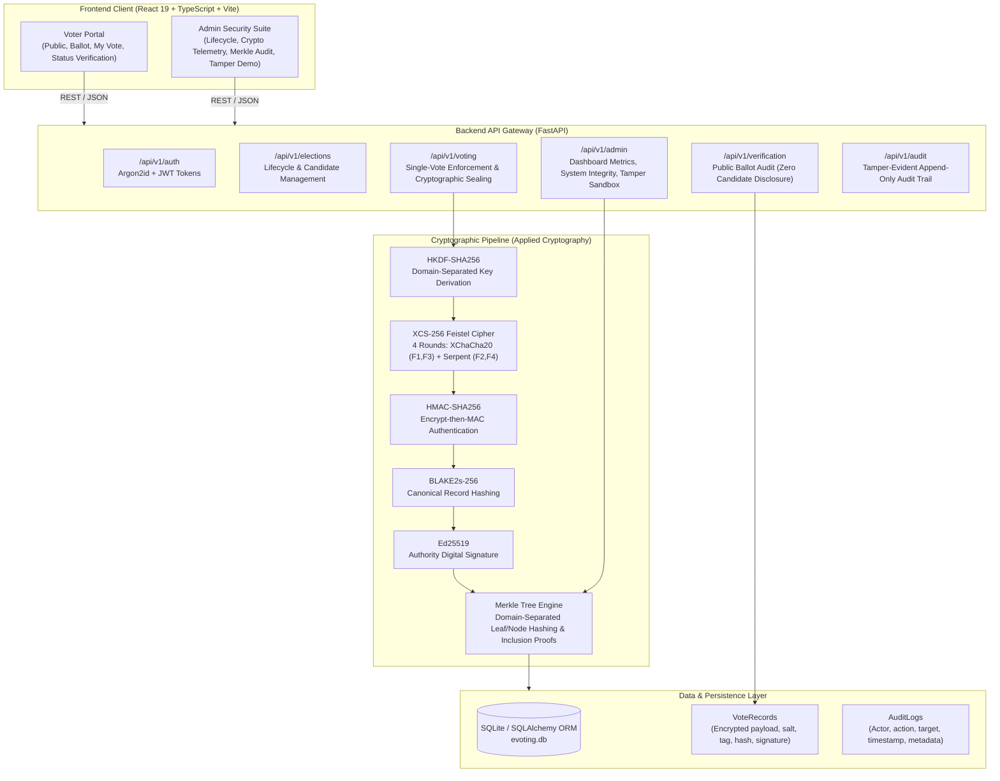

# System Architecture

## Overview

The **Secure E-Voting System with Enhanced Vote Verification and Tamper-Evident Auditing** is an end-to-end full-stack demonstration system designed for academic and research evaluation within the Cryptography and Network Security domain.

The platform provides two strictly segregated user experiences:
1. **Public and Voter Experience:** An intuitive, privacy-conscious portal where citizens register, verify their email, authenticate, inspect active elections, cast a single confidential vote, receive a non-sequential cryptographically generated Vote ID, and independently verify that their vote record is committed to the election ledger without revealing their candidate selection.
2. **Admin and Security Audit Experience:** A comprehensive governance console providing election lifecycle management, voter status administration, real-time cryptographic primitive telemetry (XCS-256, BLAKE2s, Ed25519, Merkle Tree), end-to-end ledger integrity auditing, an isolated Tamper Detection sandbox, and published results verification.

---

## High-Level Architecture Diagram

---

## Component Breakdown

### 1. Presentation Layer (`frontend/`)
- **Technology:** React 19, TypeScript, Vite, Tailwind CSS 3.4.
- **Routing:** Client-side routing with `react-router-dom` utilizing role-based route guards (`AdminRoute`, `VoterRoute`).
- **Design Philosophy:** Clean public-service aesthetics for voters (soft grays, slate, indigo accents); high-density technical console for election administrators with real-time crypto telemetry, JSON inspection, and verification visualizers.
- **Strict Privacy Separation:** The voter interface never exposes authority private keys, intermediate Feistel round states, or internal HMAC keys. When a voter verifies their ballot status, only verification status (`VALID_RECORDED`) and timestamp are displayed—candidate choice is zeroized.

### 2. Application & API Layer (`backend/app/`)
- **Technology:** Python 3.13, FastAPI, Pydantic V2, Starlette.
- **Authentication & RBAC:**
  - Password hashing: Argon2id (`argon2-cffi`) with secure parameters (time cost = 2, memory cost = 64 MiB, parallelism = 1).
  - Sessions: Stateless JWT bearer tokens with expiration and signature verification.
  - Role-Based Access Control (RBAC): Strict server-side dependencies (`require_admin`, `require_verified_voter`).
- **Transaction Safety & Double-Voting Prevention:**
  - SQLite unique constraint on `(voter_id, election_id)`.
  - Atomic database transactions wrapped around ballot validation, cryptographic sealing, and ledger recording.

### 3. Applied Cryptography Engine (`backend/app/crypto/`)
- **Key Derivation (`key_derivation.py`):** Master Authority Key (256-bit) and fresh 16-byte record salt expanded into 8 distinct keys using HKDF-SHA256 with ASCII domain strings (`xcs256-f1-xchacha-roundkey`, `xcs256-f2-serpent-roundkey`, etc.).
- **Hybrid Feistel Network (`feistel.py`):** 4-round balanced Feistel structure operating on 256-bit blocks (128-bit halves $L$ and $R$).
- **Round Functions:**
  - Rounds 1 & 3: Raw XChaCha20 stream cipher output derived from $R_{i-1}$ and round nonce.
  - Rounds 2 & 4: 128-bit block Serpent block cipher using 256-bit derived key via verified `pyserpent.Serpent`.
- **Mode of Operation (`xcs256.py`):** Multi-block Cipher Block Chaining (CBC) with 32-byte PKCS#7 padding.
- **Integrity & Authenticity (`authentication.py`):** Encrypt-then-MAC using HMAC-SHA256 over version byte, public salt, CBC IV, associated data, and ciphertext.
- **Canonical Serialization (`serialization.py`):** RFC 8785 compliant canonical deterministic JSON serialization with lexicographical key ordering and strict UTF-8 formatting.
- **Record Digest (`hashing.py`):** BLAKE2s-256 digest of canonical vote record.
- **Authority Signature (`signatures.py`):** Pure Ed25519 signature over BLAKE2s record hash.
- **Audit Ledger (`merkle_tree.py`):** Binary Merkle tree with prefix domain separation (`0x00` for leaves, `0x01` for internal nodes) providing $O(\log N)$ inclusion proofs.

---

## Data Flow: Complete Voting Workflow

1. **Voter Registration & Verification:** Voter registers with email and password. Account requires email verification token before voting eligibility is activated.
2. **Election Inspection:** Voter queries active elections. Eligibility is verified on backend (election status = `OPEN`, voter email verified = `true`, no existing vote record for `(voter_id, election_id)`).
3. **Ballot Casting:**
   - Voter selects candidate and submits ballot.
   - Backend derives fresh cryptographic keys via HKDF-SHA256 from authority secret + record salt.
   - Payload is encrypted with 4-round XCS-256 Feistel cipher in CBC mode.
   - HMAC-SHA256 authentication tag is computed and attached.
   - Non-sequential Vote ID (`VOTE-XXXX-XXXX-XXXX`) is assigned.
   - Record metadata is canonically serialized and hashed with BLAKE2s-256.
   - Authority Ed25519 private key signs the BLAKE2s record hash.
   - Record is committed to database; Merkle tree leaf index is registered.
4. **Receipt Generation:** Voter receives Vote ID receipt.
5. **Independent Audit:** Voter or observer queries `/api/v1/verification/verify?vote_id=...`. System retrieves record, validates HMAC tag, re-verifies BLAKE2s hash, verifies Ed25519 authority signature, generates Merkle inclusion proof, and confirms root match—without disclosing candidate choice.
