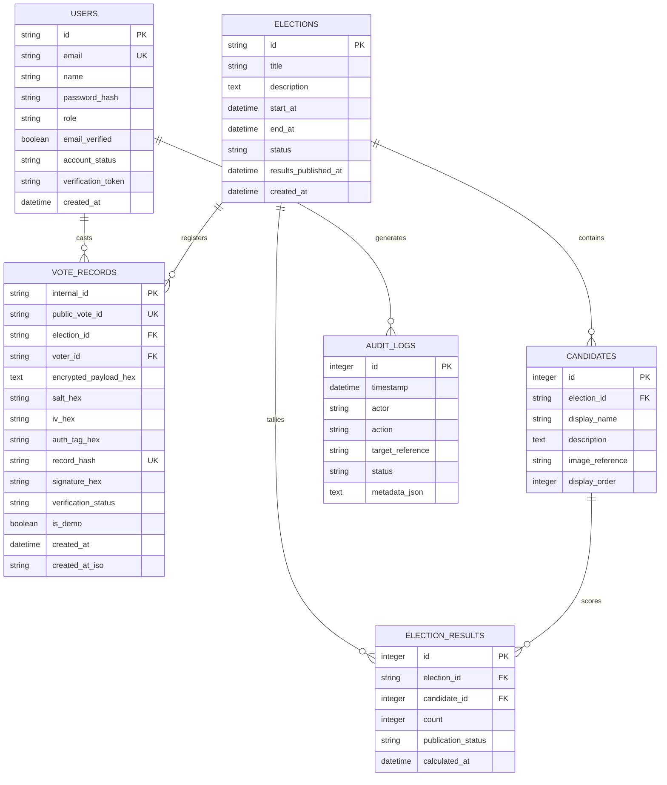

# Database Schema and Data Models

## 1. Entity-Relationship Diagram

---

## 2. Table Specifications

### 2.1 Table: `users`
Stores user identities for both voters and administrators.
- `id` (VARCHAR(36), PK): UUIDv4 string.
- `email` (VARCHAR(255), UNIQUE, NOT NULL, INDEX): Normalized user email.
- `name` (VARCHAR(255), NOT NULL): Full display name.
- `password_hash` (TEXT, NOT NULL): Argon2id password hash string.
- `role` (VARCHAR(50), NOT NULL, DEFAULT `'voter'`): Either `'voter'` or `'admin'`.
- `email_verified` (BOOLEAN, NOT NULL, DEFAULT `FALSE`): Verification status.
- `account_status` (VARCHAR(50), NOT NULL, DEFAULT `'ACTIVE'`): `'ACTIVE'` or `'DEACTIVATED'`.
- `verification_token` (VARCHAR(255), NULLABLE): Token for email verification.
- `created_at` (DATETIME, NOT NULL): Account creation timestamp.

### 2.2 Table: `elections`
Governs election scope and lifecycle.
- `id` (VARCHAR(36), PK): UUIDv4 string.
- `title` (VARCHAR(255), NOT NULL): Election title.
- `description` (TEXT, NULLABLE): Descriptive background.
- `start_at` (DATETIME, NOT NULL): Election opening time.
- `end_at` (DATETIME, NOT NULL): Election closing time.
- `status` (VARCHAR(50), NOT NULL, DEFAULT `'DRAFT'`): `'DRAFT'`, `'OPEN'`, `'CLOSED'`, or `'CANCELLED'`.
- `results_published_at` (DATETIME, NULLABLE): Timestamp when verified results were officially published.
- `created_at` (DATETIME, NOT NULL): Creation timestamp.

### 2.3 Table: `candidates`
Candidates eligible for ballot selection in a specific election.
- `id` (INTEGER, PK, AUTOINCREMENT): Unique candidate ID.
- `election_id` (VARCHAR(36), FK -> `elections.id`, NOT NULL, INDEX): Associated election.
- `display_name` (VARCHAR(255), NOT NULL): Candidate name.
- `description` (TEXT, NULLABLE): Candidate bio or manifesto.
- `image_reference` (VARCHAR(255), NULLABLE): Avatar URL or path.
- `display_order` (INTEGER, NOT NULL, DEFAULT `0`): Display sequence on the ballot.

### 2.4 Table: `vote_records`
Cryptographically sealed ballot ledger.
- `internal_id` (VARCHAR(36), PK): Private backend tracking UUID.
- `public_vote_id` (VARCHAR(64), UNIQUE, NOT NULL, INDEX): Non-sequential public receipt ID (`VOTE-XXXX-XXXX-XXXX`).
- `election_id` (VARCHAR(36), FK -> `elections.id`, NOT NULL, INDEX): Target election.
- `voter_id` (VARCHAR(36), FK -> `users.id`, NOT NULL): Cast voter ID.
- `encrypted_payload_hex` (TEXT, NOT NULL): Hex-encoded XCS-256 ciphertext.
- `salt_hex` (VARCHAR(64), NOT NULL): 16-byte random cryptographic salt.
- `iv_hex` (VARCHAR(64), NOT NULL): 32-byte derived CBC initialization vector.
- `auth_tag_hex` (VARCHAR(64), NOT NULL): 32-byte HMAC-SHA256 Encrypt-then-MAC tag.
- `record_hash` (VARCHAR(64), UNIQUE, NOT NULL, INDEX): 32-byte BLAKE2s digest.
- `signature_hex` (TEXT, NOT NULL): 64-byte Ed25519 digital signature.
- `verification_status` (VARCHAR(50), NOT NULL, DEFAULT `'RECORDED'`): `'RECORDED'`, `'VALID_RECORDED'`, `'TAMPERED'`.
- `is_demo` (BOOLEAN, NOT NULL, DEFAULT `FALSE`): Sandbox flag for tamper demonstration.
- `created_at` (DATETIME, NOT NULL): Creation timestamp.
- `created_at_iso` (VARCHAR(32), NOT NULL): Strict canonical ISO-8601 string (`YYYY-MM-DDTHH:MM:SSZ`) guaranteeing byte-level serialization stability.

> **CRITICAL UNIQUE CONSTRAINT:**
> `UNIQUE (voter_id, election_id)`
> Strictly enforced at the database layer to physically prevent double-voting.

### 2.5 Table: `audit_logs`
Append-only system audit trail.
- `id` (INTEGER, PK, AUTOINCREMENT): Sequential log index.
- `timestamp` (DATETIME, NOT NULL): Event timestamp.
- `actor` (VARCHAR(255), NOT NULL): User ID or system service.
- `action` (VARCHAR(100), NOT NULL): Operation name (`VOTE_SUBMISSION`, `ELECTION_STATUS_CHANGE`, `TAMPER_MUTATION`, etc.).
- `target_reference` (VARCHAR(255), NULLABLE): Related resource ID.
- `status` (VARCHAR(50), NOT NULL): `'SUCCESS'`, `'WARNING'`, or `'FAILURE'`.
- `metadata_json` (TEXT, NULLABLE): Sanitized event payload (never stores plaintext votes or private keys).

### 2.6 Table: `election_results`
Calculated and published results.
- `id` (INTEGER, PK, AUTOINCREMENT): Result entry ID.
- `election_id` (VARCHAR(36), FK -> `elections.id`, NOT NULL, INDEX): Associated election.
- `candidate_id` (INTEGER, FK -> `candidates.id`, NOT NULL): Candidate ID.
- `count` (INTEGER, NOT NULL, DEFAULT `0`): Verified vote count.
- `publication_status` (VARCHAR(50), NOT NULL, DEFAULT `'DRAFT'`): `'DRAFT'` or `'PUBLISHED'`.
- `calculated_at` (DATETIME, NOT NULL): Timestamp of tally calculation.
